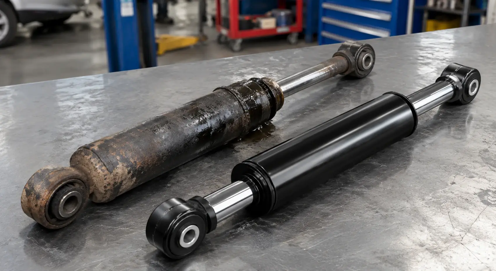
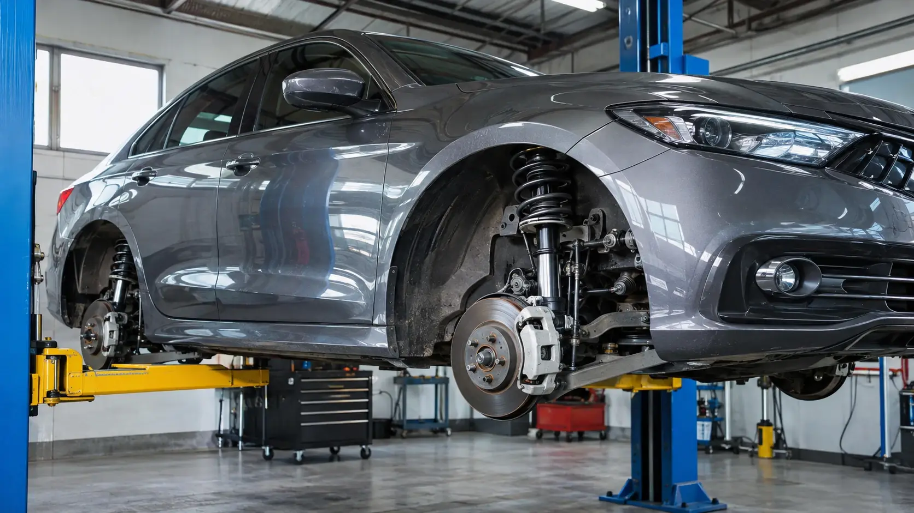

> Cuándo cambiar los amortiguadores en Guayaquil: siete señales de desgaste, revisión de suspensión, cambio en pares y diagnóstico gratuito.

# Cuándo cambiar los amortiguadores: 7 señales de que están dañados

Saber cuándo cambiar los amortiguadores en Guayaquil empieza por observar cómo responde tu carro al frenar, pasar baches y tomar curvas. Los rebotes, las fugas y la inestabilidad son motivos para revisar la suspensión.

> **Resumen:** No hay un kilometraje único para cambiar amortiguadores. Revisa rebotes, hundimiento al frenar, golpes, ruidos, desgaste de llantas, fugas y balanceo. El diagnóstico identifica la causa; si corresponde reemplazarlos, se recomienda hacerlo en pares por eje.

Por [Luciano Arteaga](/about#luciano-arteaga) · Mecánico automotriz

Publicado: 2026-11-06 · Modificado: 2026-11-06

## Qué hace el amortiguador

El resorte soporta la carga y se comprime al pasar una irregularidad. El amortiguador controla sus oscilaciones para que la carrocería deje de rebotar y la llanta mantenga el contacto con el piso. Trabaja tanto al comprimirse como al extenderse.

Cuando pierde capacidad de amortiguación, el carro puede sentirse flotante y responder peor en maniobras y frenadas. No es solo comodidad: la suspensión influye en el control del vehículo.

## Las 7 señales de que los amortiguadores están dañados

### 1. El carro rebota mucho

Después de pasar un bache o un reductor, la carrocería sigue oscilando en lugar de asentarse. Es una señal de que conviene revisar la capacidad de amortiguación.

### 2. Se hunde demasiado al frenar

Cierta inclinación hacia adelante es normal, pero un hundimiento excesivo o un movimiento que continúa después de frenar merece revisión. También hay que descartar problemas en resortes y otras piezas.

### 3. Hay golpeteo al pasar baches

Un golpe seco puede venir de un amortiguador, una base o una unión con holgura. Identifica en qué lado y en qué situación aparece, sin repetir el impacto para probarlo.

### 4. Escuchas ruidos en la suspensión

Chirridos o crujidos al girar o al mover la carrocería pueden relacionarse con bases, bujes o articulaciones. Un ruido por sí solo no demuestra que el amortiguador deba cambiarse.

### 5. Las llantas se desgastan de forma irregular

Zonas de desgaste alternado o en forma de ondas pueden acompañar una amortiguación deficiente. También se revisan presión, alineación y balanceo antes de atribuir el desgaste a una sola pieza.

### 6. Hay fuga de aceite en el cuerpo del amortiguador

Un escurrimiento visible puede indicar pérdida del fluido de trabajo. Hay que distinguir una fuga activa de suciedad o una película superficial; limpiar e inspeccionar ayuda a evaluar el estado.

### 7. Sientes inestabilidad o balanceo en curvas y con viento

Un balanceo mayor al habitual o la necesidad de corregir constantemente la dirección exige revisar suspensión, llantas y dirección. Evita maniobras bruscas para comprobarlo.

Si el problema aparece al frenar, también conviene revisar el [sistema de frenos y dirección](/sistema-de-frenos-guayaquil) y las [señales de desgaste de las pastillas](/blog/cuando-cambiar-pastillas-de-freno).

## La prueba del rebote solo sirve como orientación

Con el carro estacionado en una superficie firme y nivelada, motor apagado y freno de estacionamiento aplicado, presiona con fuerza una esquina de la carrocería y suelta, sin apoyarte en piezas frágiles. Debe subir y asentarse casi de inmediato; si rebota varias veces, conviene revisarlo.

Esta prueba no mide el rendimiento del amortiguador ni detecta todas las fallas. Que el carro se asiente no significa que la suspensión esté sana. No te metas debajo del vehículo para inspeccionarlo sin los medios adecuados.

## Cómo influyen los baches de Guayaquil

Las calles con baches de Guayaquil someten la suspensión a impactos repetidos que pueden acelerar el desgaste. La carga, la velocidad al pasar irregularidades y el estado de las llantas también influyen; por eso no existe un kilometraje único de reemplazo.

Reduce la velocidad antes de un bache cuando puedas hacerlo con seguridad y evita sobrecargar el carro. Incorpora la revisión de suspensión al [mantenimiento preventivo](/mantenimiento-preventivo-guayaquil), especialmente si notas cambios después de un golpe fuerte.

## Por qué se cambian en pares por eje

Se recomienda reemplazar los dos amortiguadores del mismo eje para mantener una respuesta equilibrada entre izquierda y derecha. Mezclar uno nuevo con otro desgastado puede producir diferencias de control durante frenadas y curvas.

Cambiar solo los delanteros o solo los traseros puede ser adecuado si la revisión confirma que el otro eje está en buen estado. Los repuestos deben corresponder a la versión y configuración de suspensión del vehículo.

## Qué piezas se revisan al mismo tiempo

La revisión debe incluir **bases o cazoletas, fuelles, resortes, rótulas, terminales y bujes**. Las bases sujetan el conjunto; los fuelles protegen el vástago; los resortes soportan la carga; las articulaciones y bujes permiten movimientos controlados.

Una pieza con holgura puede provocar ruidos aunque el amortiguador esté bien. Cambiar únicamente el amortiguador no corrige ese origen. Después del trabajo se recomienda alinear y balancear para complementar la revisión de suspensión y llantas; son ajustes distintos y ninguno sustituye reparar piezas dañadas.

## Diagnóstico gratuito, precio y garantía en Autonation

El diagnóstico gratuito de Autonation revisa amortiguadores y suspensión para identificar el origen de los síntomas. Se comprueban fugas, desgaste y holguras en las piezas relacionadas antes de recomendar el reemplazo. Describe cuándo aparecen los ruidos y si hubo un golpe reciente.

El cambio de amortiguadores se ofrece **desde $70 + IVA; el valor final depende del vehículo y del repuesto y se confirma tras el diagnóstico**. Los trabajos de amortiguadores tienen garantía escrita. Consulta el servicio de [cambio de amortiguadores en Guayaquil](/cambio-amortiguadores-guayaquil) para solicitar la revisión.

Si además se eleva la temperatura del motor, ese síntoma requiere una evaluación diferente: consulta [reparación de motores](/reparacion-motores-guayaquil) y la guía de [qué hacer con un motor recalentado](/blog/motor-recalentado-que-hacer-guayaquil).

## Preguntas frecuentes

### ¿Cada cuánto se cambian los amortiguadores?

Depende del uso, la carga y el estado de las calles. No hay un kilometraje único para todos los vehículos: la revisión permite determinar si hay desgaste, daños o pérdida de capacidad de amortiguación.

### ¿Se pueden cambiar solo dos?

Sí, se pueden cambiar los dos del mismo eje si la revisión confirma que los del otro eje están en buen estado. Se recomienda reemplazarlos en pares por eje para mantener una respuesta equilibrada.

### ¿Un amortiguador con fuga se puede reparar?

Normalmente se reemplaza. La mayoría de los amortiguadores de vehículos de uso diario son unidades selladas; primero hay que confirmar que existe una fuga y seguir la indicación del fabricante para ese componente.

### ¿Cuánto cuesta cambiar amortiguadores?

Desde $70 + IVA; el valor final depende del vehículo y del repuesto y se confirma tras el diagnóstico. En Autonation el diagnóstico es gratuito y los trabajos de amortiguadores tienen garantía escrita.

### ¿Es seguro manejar con amortiguadores gastados?

El desgaste afecta el contacto de las llantas con el piso, el frenado y la estabilidad. Solicita revisión y evita seguir usando el vehículo si presenta inestabilidad marcada o piezas dañadas; coordina un traslado seguro.

[Cambio de amortiguadores en Guayaquil](/cambio-amortiguadores-guayaquil) · [Agendar por WhatsApp](https://wa.me/593939057454?text=Hola%2C%20quiero%20un%20diagn%C3%B3stico%20de%20suspensi%C3%B3n%20y%20cotizar%20el%20cambio%20de%20amortiguadores)

---

**Autonation Taller Multimarca** — La Aurora, detrás del Edificio Milenium (Daule, Guayas, Ecuador), cerca de Guayaquil y Samborondón.

Más contenido: [Inicio](https://www.autonation.com.ec/) · [Mapa del sitio](https://www.autonation.com.ec/sitemap.xml) · [llms.txt](https://www.autonation.com.ec/llms.txt)

URL canónica: https://www.autonation.com.ec/blog/cuando-cambiar-amortiguadores-guayaquil
