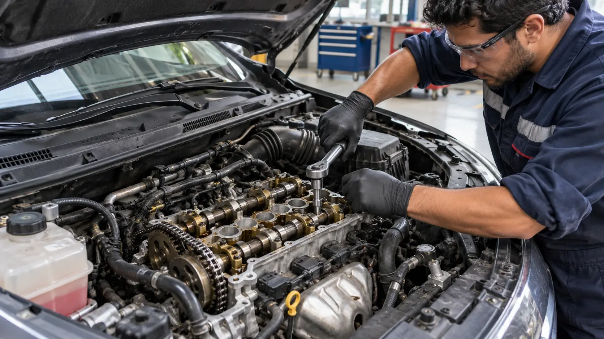
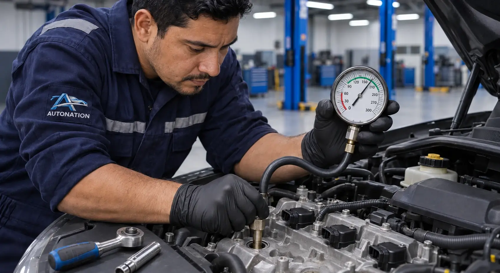

> Motor recalentado en Guayaquil: cómo detenerte con seguridad, causas frecuentes y señales para revisar la culata antes de volver a manejar.

# Motor recalentado: qué hacer y qué causas revisar en Guayaquil

Un motor recalentado en Guayaquil exige detenerte con seguridad: seguir manejando puede agravar una falla del sistema de enfriamiento. Aquí tienes los pasos para actuar y las causas que conviene revisar.

> **Resumen:** Apaga el motor en un lugar seguro. No abras la tapa del radiador ni del depósito presurizado en caliente y no eches agua fría sobre el motor. Espera a que se enfríe antes de revisar el refrigerante; si la temperatura sigue alta, solicita una grúa.

Por [Luciano Arteaga](/about#luciano-arteaga) · Mecánico automotriz

Publicado: 2026-11-06 · Modificado: 2026-11-06

## Qué hacer en los primeros minutos

Enciende las luces de emergencia, busca un lugar seguro para detenerte y apaga el motor. No te quedes junto al tránsito ni intentes llegar al taller con la aguja alta. Si sale vapor, mantente alejado y espera a que desaparezca antes de acercarte al capó.

- **No abras la tapa del radiador ni del depósito presurizado en caliente:** el refrigerante puede salir a presión y causar quemaduras.
- **No eches agua fría sobre el motor caliente.** El cambio brusco de temperatura puede dañar componentes.
- Espera a que el motor y el sistema de enfriamiento estén completamente fríos. No hay un tiempo fijo que garantice que sea seguro abrir una tapa.
- Con el carro nivelado y frío, revisa el nivel del depósito según las marcas y el manual. No acerques las manos al electroventilador: puede activarse incluso con el motor apagado.

Rellenar no corrige una fuga ni demuestra que el problema desapareció. Si la aguja sigue alta, vuelve a subir o hay pérdida de refrigerante, no sigas manejando: solicita [una grúa para trasladar el vehículo](/grua-24-horas-guayaquil).

## Causas frecuentes de un motor recalentado

El calor debe salir del motor mediante el refrigerante, el radiador y el flujo de aire. Una falla en cualquiera de esos puntos puede elevar la temperatura.

- **Fuga o nivel bajo de refrigerante:** reduce la capacidad de transportar calor. Busca manchas sin tocar piezas calientes.
- **Termostato:** si se queda cerrado, puede impedir la circulación hacia el radiador.
- **Bomba de agua:** una fuga o daño interno puede afectar la circulación.
- **Electroventilador:** una falla del ventilador, su alimentación o su control puede reducir el enfriamiento, especialmente con el carro detenido.
- **Radiador obstruido:** una obstrucción interna o suciedad exterior puede limitar el intercambio de calor.
- **Tapa del radiador o depósito:** si no regula la presión correctamente, puede favorecer pérdidas y ebullición.
- **Mangueras:** grietas, uniones flojas o deformaciones pueden causar fugas o restringir el paso.
- **Empaque de culata:** una falla de sellado puede comunicar circuitos que deben permanecer separados.

La aguja alta indica un problema; no identifica por sí sola la pieza culpable. Cambiar componentes sin comprobar la causa puede dejar la falla pendiente.

## Señales que hacen sospechar del empaque de culata

El humo blanco persistente por el escape, el aceite con aspecto lechoso, la pérdida de refrigerante sin fuga visible y las burbujas anormales en el depósito justifican una revisión. No abras el depósito caliente para buscar burbujas.

Estas señales **no confirman por sí solas un empaque dañado**. El vapor al arrancar puede ser condensación; un residuo en la tapa de aceite puede relacionarse con humedad, y las burbujas pueden tener otras causas, como aire atrapado. Hay que interpretar los síntomas juntos y comprobar el origen antes de desarmar.

## Por qué seguir manejando puede dañar el motor

El exceso de temperatura puede deformar la culata y comprometer el sellado del empaque. También puede afectar la lubricación y favorecer daños por fricción en piezas internas. Una falla de enfriamiento puede terminar requiriendo una reparación de motor si continúas circulando.

Que la aguja baje después de apagar el carro no demuestra que la causa se haya resuelto. Evita arrancarlo repetidamente para probar si ya pasó.

## Qué debe revisar el taller en el diagnóstico

Una evaluación de recalentamiento debe empezar por la inspección del sistema de enfriamiento: nivel y estado del refrigerante, fugas, mangueras, tapa, radiador y funcionamiento de la circulación y del ventilador. Según los hallazgos, una prueba de presión puede ayudar a localizar pérdidas.

Cuando se sospecha del empaque de culata, la medición de compresión puede aportar información sobre el sellado de los cilindros. Un resultado aislado no descarta todas las fugas internas: el técnico decide qué comprobaciones adicionales hacen falta.

Autonation publica **diagnóstico computarizado, medición de compresión y presupuesto por escrito** en su servicio de [reparación de motores en Guayaquil](/reparacion-motores-guayaquil). El diagnóstico es gratuito y los trabajos de motor tienen garantía escrita. Las pruebas necesarias se determinan según el caso.

## Cuándo conviene reparar el motor y cómo prevenir otra falla

No todo recalentamiento requiere reconstruir el motor. Si el daño se limita al sistema de enfriamiento, puede bastar con reparar su causa. Si hay deformación, pérdida de compresión o daño interno, conviene comparar el alcance de la reparación, el estado del bloque y la culata, los repuestos y el presupuesto antes de decidir.

Consulta también la guía sobre [reparar o cambiar el motor](/blog/reparar-o-cambiar-motor-ecuador). La decisión debe apoyarse en el estado real de tu vehículo.

Revisa el refrigerante con regularidad y siempre con el motor frío; utiliza la especificación indicada en el manual y no mezcles productos incompatibles. Incluye el sistema de enfriamiento en el [mantenimiento preventivo](/mantenimiento-preventivo-guayaquil). Si además notas rebotes o balanceo, solicita una revisión del servicio de [amortiguadores y suspensión](/cambio-amortiguadores-guayaquil): es un problema diferente que también merece atención.

## Preguntas frecuentes

### ¿Puedo seguir manejando si el motor se recalienta?

No. Detente en un lugar seguro y apaga el motor. Si la aguja sigue alta, vuelve a subir o hay pérdida de refrigerante, pide una grúa; continuar puede agravar el daño.

### ¿Puedo echarle agua al radiador?

No abras el radiador ni el depósito presurizado en caliente, y no eches agua fría sobre el motor caliente. Con el sistema completamente frío, sigue el manual y usa el refrigerante especificado. El agua sola no sustituye el refrigerante ni soluciona la causa del recalentamiento.

### ¿Cuánto debo esperar para abrir la tapa?

Hasta que el motor y el sistema de enfriamiento estén completamente fríos. No hay un tiempo fijo seguro para todos los vehículos. Si tienes dudas, no abras la tapa y solicita asistencia.

### ¿Cómo sé si es el empaque de culata?

Humo blanco persistente, aceite lechoso, pérdida de refrigerante sin fuga visible o burbujas anormales pueden orientar la revisión, pero no confirman la falla. Hace falta diagnóstico y, según el caso, medición de compresión y otras comprobaciones.

### ¿Cada cuánto debo revisar el refrigerante?

Revísalo con regularidad y siempre con el motor frío. Sigue el manual de tu vehículo y solicita revisión si el nivel baja repetidamente: rellenar sin buscar la causa no resuelve el problema.

[Reparación de motores en Guayaquil](/reparacion-motores-guayaquil) · [Agendar por WhatsApp](https://wa.me/593939057454?text=Hola%2C%20mi%20motor%20se%20recalent%C3%B3%20y%20quiero%20solicitar%20un%20diagn%C3%B3stico)

---

**Autonation Taller Multimarca** — La Aurora, detrás del Edificio Milenium (Daule, Guayas, Ecuador), cerca de Guayaquil y Samborondón.

Más contenido: [Inicio](https://www.autonation.com.ec/) · [Mapa del sitio](https://www.autonation.com.ec/sitemap.xml) · [llms.txt](https://www.autonation.com.ec/llms.txt)

URL canónica: https://www.autonation.com.ec/blog/motor-recalentado-que-hacer-guayaquil
